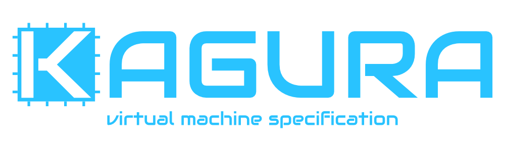

# Kagura

- [documentation](https://super-shrine.github.io/kagura/)

KaguraはCPU ISAとbus契約に焦点を当てた汎用VM基盤の規格です。

`specs/`はこのリポジトリの本体であり、Kaguraの適合要件を定義する唯一の規範です。\
`support/`にある参照実装とツールは、仕様の理解と検証を支援する非規範の付属物です。

規範資料は次を管理します。

- Kagura CPU ISAとbus契約
- Kagura適合試験protocol
- 実装に依存しない適合試験case
- 規範要件とcaseを対応付けるcoverage manifest

## 内容

| パス | 役割 |
| --- | --- |
| [Kagura規範仕様](./specs/kagura/v1/README.md) | CPU ISAとbus contract |
| [適合試験仕様](./specs/kagura/v1/conformance/README.md) | 適合試験仕様、coverage、test case |
| [`support`](./support/README.md) | 非規範のRust参照実装、conformance runner、開発ツール |

適合試験の規範入力とrunnerによる取り扱いは、[適合試験仕様の「正とする情報」](./specs/kagura/v1/conformance/README.md#正とする情報)で定義します。

## 規範範囲

`support/`の挙動と文書はKagura VM規格の一部ではありません。\
実装と仕様が食い違う場合は`specs/`を正とします。\
`support/`は仕様versionとは独立して更新でき、製品固有のmachine構成や統合規約は各製品側で管理します。

このテストでは、同じリポジトリにある規範適合試験suiteを直接使用します。

## バージョン

- 仕様書のversionは[`specs/README.md`](./specs/README.md)の記載だけを正とします
- Git tagは`support/`全体のversionとし、SemVerの数値をそのまま使い、`v` prefixは付けません
- 仕様書とsupportのversionは独立して更新し、supportのrelease noteに対応する仕様書versionを記載します

例えば、support versionが`0.2.0`の場合、Git tagも`0.2.0`とします。

## ライセンス

このリポジトリは[MIT License](./LICENSE.md)で公開します。
